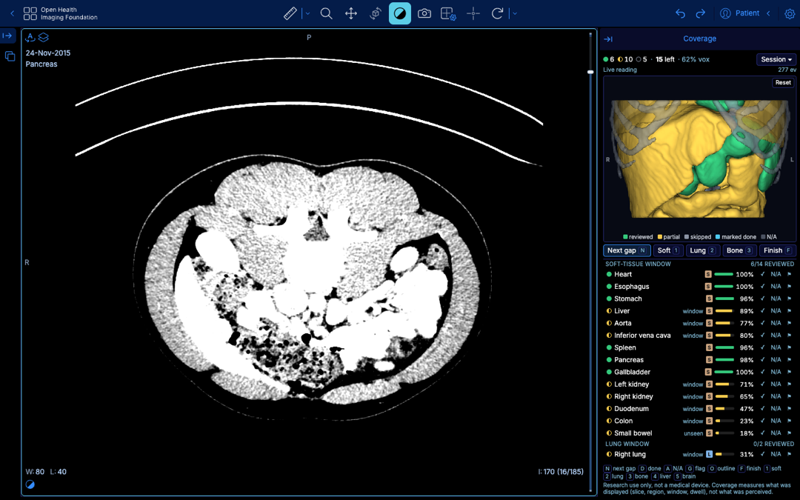

# Coverage Map

Coverage Map shows which organs a reader actually looked at while reading a CT scan. It runs
inside the OHIF viewer, records what the screen displayed, and colors each organ on a live 3D
model: **reviewed** (green), **partly reviewed** (yellow) or **skipped** (gray).

> **Research use only. Not a medical device.** Coverage measures what the viewer displayed, not
> what a reader perceived or concluded. A green organ does not prove clinical review.



## Features

- Live per-organ coverage while you scroll, pan, zoom and switch window presets.
- A 3D organ map. Click a gray or yellow organ to jump to its next gap.
- **Next gap** (`N`) jumps to the next unreviewed region with the right window.
- **Finish** (`F`) lists what is still gray or yellow before you confirm.
- Session tools: load a sample reading, replay a session, adjust the reading rules, and export
  the event log and coverage.
- A JSON command-line interface to fetch cases, segment organs, simulate readings and score them
  offline.

## How it works

A voxel counts toward its organ when all three are true:

1. It was inside the visible region of a displayed slice.
2. The window suited the organ (lung, bone or soft tissue).
3. It stayed on screen for at least the minimum dwell time.

| Part | Built with |
|---|---|
| Viewer | OHIF 3.13.13 and Cornerstone3D 5, with a custom `coverage` mode and extension (`ohif/`) |
| Images | Orthanc 1.13 with the DICOMweb plugin, behind the app server's same-origin proxy |
| Organs | TotalSegmentator 2.18 (`total` task): organ labels in the DICOM grid plus surface meshes |
| Scoring | Python (`covmap/scoring.py`) |
| 3D map | vtk.js, shared by the OHIF panel and `covmap render` |
| API | aiohttp (`covmap serve`): sessions, live scoring, meshes, samples, export, DICOMweb proxy |

[docs/SPEC.md](docs/SPEC.md) defines every data file, API route and CLI command.

## Requirements

- A macOS host that runs the services, reachable over SSH. Full-resolution segmentation peaks
  at about 7 GB of memory.
- [uv](https://docs.astral.sh/uv/) on that host. The setup script installs Python 3.12, Node 24,
  pnpm, Orthanc, OHIF and Playwright's Chromium into one task directory. Nothing is installed
  system-wide.

The scripts read these settings from the environment ([scripts/env.sh](scripts/env.sh)):

| Variable | Default | Purpose |
|---|---|---|
| `MINI_HOST` | `mini` | SSH host that runs the services |
| `MINI_WORK` | `/Users/michaelchen/coverage-map-work` | Task directory on that host for tools, data and builds |
| `CAPACITY_GATE` | `~/.claude/skills/supervise/scripts/fleetcapacity.py` | Capacity check that `--heavy` jobs wait on |

`scripts/mini.sh -- <command>` syncs this checkout to the host and runs the command there.

## Getting started

1. Install the toolchain and build the viewer:

   ```bash
   scripts/mini.sh -- bash scripts/setup_mini.sh all
   scripts/mini.sh --heavy -- bash scripts/build_ohif.sh
   scripts/mini.sh --heavy -- bash scripts/stock_ohif.sh   # optional: unmodified OHIF for comparison
   ```

2. Prepare a case. Repeat for `lidc-0001`.

   ```bash
   scripts/mini.sh -- python -m covmap fetch --case pancreas-0051
   scripts/mini.sh -- python -m covmap orthanc-load --case pancreas-0051
   scripts/mini.sh --heavy=8 -- python -m covmap segment --case pancreas-0051
   scripts/mini.sh -- python e2e/make_sample.py --case pancreas-0051   # optional: sample reading
   ```

3. Start the app and open it:

   ```bash
   scripts/launch.sh             # starts the services and tunnels port 8765 to this machine
   open http://127.0.0.1:8765/
   scripts/launch.sh stop
   ```

## Hosting on Hugging Face

`deploy/huggingface/` packages the app as a Docker Space. The container runs Orthanc and
`covmap serve`, loads both cases into Orthanc at startup, and answers on port 7860.

```bash
deploy/huggingface/build_space.sh ../coverage-map-space   # code, viewer build and case data from the host
hf repo create mchen04/coverage-map --repo-type space --space-sdk docker
hf upload mchen04/coverage-map ../coverage-map-space --repo-type space
```

The server answers only loopback `Host` headers plus the names in `COVMAP_ALLOWED_HOSTS`. On
Hugging Face, `start.sh` sets it to the Space's own hostname.

## Usage

The start page opens the demo abdominal CT with a fresh reading session.

| Action | Input |
|---|---|
| Scroll slices | Mouse wheel |
| Soft-tissue, lung, bone window | `1`, `2`, `3` |
| Jump to the next gap | `N`, or click a gray or yellow organ in the 3D map |
| Finish the reading | `F` |

The **Session** menu loads the sample reading, replays a session, changes the reading rules and
exports the results.

### Command line

Every command prints one JSON object.

```bash
python -m covmap fetch --case lidc-0001            # public TCIA download, provenance and hashes
python -m covmap orthanc-load --case lidc-0001
python -m covmap segment --case lidc-0001          # TotalSegmentator: labels, organs, meshes
python -m covmap scenarios --case lidc-0001
python -m covmap simulate --case lidc-0001 --scenario window_skip_lung --out work/r.jsonl
python -m covmap replay --case lidc-0001 --events work/r.jsonl --out work/cov.json
python -m covmap report --case lidc-0001 --coverage work/cov.json --truth work/r.jsonl.truth.json
python -m covmap render --case lidc-0001 --coverage work/cov.json --out work/map.png
python -m covmap serve --port 8765
```

Run them on the host with `scripts/mini.sh -- python -m covmap …`. Each call re-syncs the
checkout and deletes other files there, so write outputs under `work/`.

## Testing

```bash
scripts/mini.sh --heavy -- python -m pytest -q
```

Tests marked `data` need a fetched and segmented case. Tests marked `browser` need the built
viewer, Orthanc and Chromium.

## Results

In 18 scripted readings over both CTs with known skips, Coverage Map caught all 59 intended
skips with no misses and no false alarms. OHIF's built-in viewed-image tracker and a per-image
viewed/unviewed model each caught 28. They only see slices that were never displayed. They miss
a wrong window, an off-screen region, a too-brief look, or one organ left unread.

These readings are scripted, not clinical reads, on two public CTs.

## Data

| Case | Source | Dataset DOI | License |
|---|---|---|---|
| `lidc-0001` | TCIA LIDC-IDRI, LIDC-IDRI-0001 (chest CT) | [10.7937/K9/TCIA.2015.LO9QL9SX](https://doi.org/10.7937/K9/TCIA.2015.LO9QL9SX) | CC BY 3.0 |
| `pancreas-0051` | TCIA Pancreas-CT, PANCREAS_0051 (abdominal CT) | [10.7937/K9/TCIA.2016.tNB1kqBU](https://doi.org/10.7937/K9/TCIA.2016.tNB1kqBU) | CC BY 3.0 |

Both are public, deidentified datasets that download without credentials. Each case's
`provenance.json` records its URLs, DOIs and file hashes. When you reuse the images, cite the
dataset DOIs and TCIA ([doi:10.1007/s10278-013-9622-7](https://doi.org/10.1007/s10278-013-9622-7)).

## Project layout

| Path | Contents |
|---|---|
| `covmap/` | Python package: CLI, data fetch, segmentation, scoring, app server |
| `ohif/` | OHIF `coverage` mode, extension and 3D organ map |
| `web/render/` | Standalone 3D render page used by `covmap render` |
| `e2e/` | Browser-driven readings and end-to-end runs |
| `bench/` | Benchmarks for segmentation, replay, render and page load |
| `tests/` | pytest suite |
| `scripts/` | Host setup, sync and service scripts |
| `config/` | OHIF and Orthanc configuration |
| `deploy/huggingface/` | Hugging Face Space packaging |
| `docs/SPEC.md` | Interface contract |
